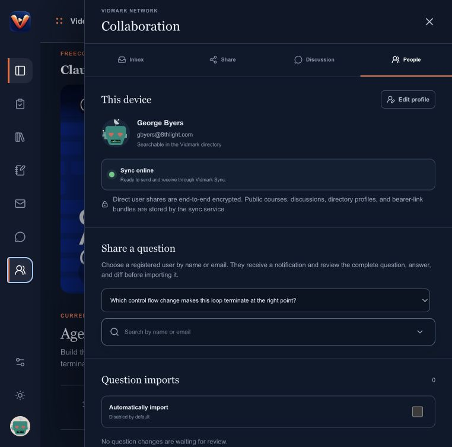
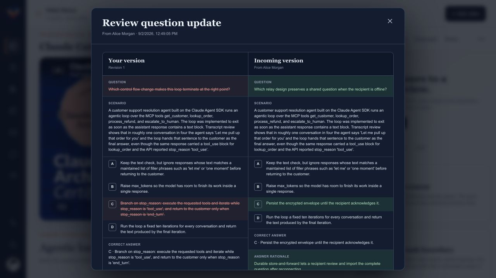

# Vidmark

**Turn source material into an agent-built course, then study it, revise it, and share it.**

Vidmark is a local-first macOS study workspace with an integrated MCP server. It combines YouTube transcripts, timestamped chapters, study guides, notes, concept graphs, practice questions, exam sessions, and asynchronous collaboration in one app.

`macOS 13+` · `Apple Silicon` · `Local SQLite` · `MCP` · `Encrypted direct sharing`



## Features

- Build courses from web sources or YouTube videos with Claude or another MCP-capable agent. A primary video is optional.
- Organize reading-based chapters with optional supporting videos, chapter practice, and course-specific timed exams. Questions and concept graphs stay with shared course bundles.
- Acquire available public YouTube captions when a transcript is not supplied.
- Study with timestamped chapters, transcript search, text and voice notes, concept graphs, practice questions, and exams. Voice notes use Apple Speech on-device when available.
- Customize the global model instructions Vidmark uses for course building and specialist agents.
- Find registered Vidmark users by name or email and share courses, questions, answers, suggestions, and notes.
- Review incoming question changes in a side-by-side diff before importing them. Automatic question import is optional and disabled by default.
- Publish a course associated with a YouTube video ID, fork it when editing, propose revisions, and participate in its public discussion thread.
- Receive native macOS notifications for invitations, shared content, revisions, and replies.

### Review shared question updates

Question shares arrive as pending imports. The recipient can compare their local version with the incoming question, answer, rationale, and decision rule before accepting it. Automatic import is available as a per-user preference and is off by default.



## Download

| Artifact | Purpose |
| --- | --- |
| [Vidmark 1.3.3 for macOS](releases/Vidmark-1.3.3.dmg) | Complete desktop application |
| [Claude Desktop MCP Bundle](releases/Vidmark-1.3.3.mcpb) | Preferred Claude Desktop extension |
| [Claude Desktop DXT build](releases/Vidmark-1.3.3.dxt) | Compatibility package for Claude versions that request `.dxt` |

Open the disk image, drag Vidmark to Applications, and launch it. The repository build is ad-hoc signed rather than Apple-notarized, so the first launch may require Control-clicking Vidmark, choosing **Open**, and confirming.

Vidmark checks its signed HTTPS update feed automatically and installs verified updates in the background. Choose **Vidmark → Check for Updates…** to check immediately.

## Using Vidmark

1. Create a profile with your name, email, and DiceBear avatar. The email identifies you in the Vidmark directory; the app does not send email.
2. Add a course title, source URL (web page or YouTube), course-specific prompt, and its credit.
3. Choose a provider in **Settings → Course agent** and save preferences, then use **Build with agent** on the course overview. You can also connect an external MCP client and request the `build_vidmark_course` prompt.
4. Study the generated course locally.
5. Share a complete course or an individual artifact with a registered user, or create a revocable course link.

Each course owns its source link, optional primary video and transcript, chapters (including optional supporting videos), study guide, question bank, and independently revisioned concept graph. These artifacts stay together when the course is shared or published.

### Course agents

Vidmark detects installed **Codex CLI** and **Claude Code CLI** and checks their sign-in status. Sign in from Terminal with `codex login` or `claude auth login`, then choose **Refresh detection**. Recent CLI versions are required for isolated builds; the picker explains when an update is needed.

**Settings → Course agent** has icon radio cards for OpenAI (Codex), Anthropic / Claude, and the optional in-app local/OpenRouter coordinator. **Save preferences** remembers the provider and model on this Mac. **Automatic** follows the CLI’s current recommended model at each run; explicitly choosing a model pins it. Model catalogs are discovered, not hard-coded. If recommendation metadata is unavailable, the CLI chooses its default; Vidmark does not guess release order.

The sidebar shows your saved provider and model above Settings. Hover or focus it to see the full model name and automatic-selection status; click it to open Settings.

CLI builds use your existing account and usage limits. They receive a temporary MCP connection restricted to the selected course, without changing global MCP configuration. Course material is sent to the selected provider. Start or cancel builds from the course overview; artifacts already saved remain in SQLite. Completion requires a successful agent result and a complete course saved through MCP.

For large question banks, the CLI can stage questions incrementally and commit the complete course atomically. Incomplete or cancelled staging does not replace the library’s existing questions.

## MCP client integration

### Claude Desktop

Vidmark copies its bundled extension to:

```text
~/Library/Application Support/Vidmark/Claude Desktop/Vidmark.mcpb
```

Open Vidmark once, then choose **Vidmark → Reveal Claude Desktop Extension…**. In Claude Desktop, open **Settings → Extensions → Advanced settings → Install Extension…** and select the bundle. Use the `.dxt` download only if your Claude version requires that extension.

The extension starts Vidmark when necessary and connects Claude Desktop to the app's loopback MCP server. It does not contain a separate database.

### Claude Code and HTTP MCP clients

Keep Vidmark open and unlocked, then connect to its Streamable HTTP endpoint:

```bash
claude mcp add --transport http vidmark http://127.0.0.1:31417/mcp
claude mcp list
```

Equivalent client configuration:

```json
{
  "mcpServers": {
    "vidmark": {
      "url": "http://127.0.0.1:31417/mcp"
    }
  }
}
```

The `build_vidmark_course` prompt instructs the agent to read the course source (or acquire missing video captions), coordinate bounded specialist work, review the artifacts, and save the completed course through MCP.

## MCP tools

Vidmark exposes 46 tools:

| Capability | Tools |
| --- | --- |
| Courses | `list_courses`, `get_course`, `upsert_course` |
| Complete builds | `set_course_build_requirements`, `save_course_build`, `list_course_chapters` |
| Concept graphs | `get_course_concept_graph`, `upsert_course_concept_graph` |
| Questions | `list_course_questions`, `get_course_question`, `upsert_course_question`, `patch_course_question`, `archive_course_question`, `record_question_review`, `get_question_reviews` |
| Question suggestions | `create_question_suggestion`, `list_question_suggestions`, `review_question_suggestion` |
| Transcripts | `get_transcript`, `replace_transcript`, `acquire_course_transcript` |
| Notes | `list_notes` |
| Profile | `get_profile`, `upsert_profile` |
| Sync and directory | `get_sync_status`, `search_vidmark_users` |
| Direct sharing | `share_question_suggestion_with_user`, `share_course_question_with_user`, `share_note_with_user`, `share_course_with_user` |
| Course links | `create_course_share_link`, `import_course_share_link`, `revoke_course_share_link` |
| Inbox | `list_inbox`, `update_inbox_item`, `review_course_invite` |
| Global courses | `get_global_course`, `publish_course_version`, `make_course_private`, `import_global_course` |
| Global revisions | `list_global_course_revisions`, `review_global_course_revision` |
| Discussions | `list_course_comments`, `post_course_comment` |
| Preferences | `get_sync_preferences`, `update_sync_preferences` |

Example:

```text
Build my imported Kubernetes course. Acquire its public transcript if needed,
coordinate specialist agents, and save the course to Vidmark. Record question QA
separately when performed; leave unreviewed questions marked with an asterisk.
```

### Question review status

Questions marked `*` have no recorded agent QA for their current content, have outstanding findings, or could not be verified. They remain usable. **Fact Check** uses the saved provider to assess factual accuracy of the question, answer, close second and rationales—not writing style or question design. Its scoped tools cannot edit content. It saves a reasoned report with evidence: no inaccuracies found, potential inaccuracies, or unable to verify. Reports may reveal answers. Stale question versions cannot receive a new review.

A connected agent can also call `record_question_review`, supplying the exact revision, content hash, reviewer attribution, findings, and evidence. Editing content invalidates its review. Shared courses preserve matching review reports; an agent assessment is not a guarantee of correctness. Fact-check instructions are locally editable in **Settings → System prompts**; tool restrictions remain enforced.

Course saves are atomic and validate question structure, per-option explanations, references, and recorded quantity/coverage requirements. Settings contains model selection, automatic question imports, and opt-in local debug logging. Debug logs include tool outcomes and content hashes, not prompts, credentials, transcripts, or model responses.

## Storage and privacy

Private study data is stored at:

```text
~/Library/Application Support/Vidmark/vidmark.sqlite
```

Vidmark requires either Mac authentication (Touch ID or the Mac login password) or a six-digit Vidmark PIN before starting its local services. Vidmark stores a salted PBKDF2 verifier rather than the PIN itself. This protects access through the app; disk-level protection of the SQLite file depends on the Mac user account and FileVault.

System-prompt overrides are stored locally in `system-prompts.json`. Voice recordings remain on the Mac under the Vidmark application-support directory. Vidmark has no cloud-transcription fallback: Apple Speech processes recordings on-device, and recordings remain saveable without a transcript when local recognition is unavailable. macOS may download Apple's language model before first use, but does not upload the recording for recognition.

| Boundary | Data |
| --- | --- |
| Local Mac | Private courses, transcripts, prompts, questions, concept graphs, notes, progress, exams, and model settings |
| End-to-end encrypted delivery | Courses, questions and answers, suggestions, and note text sent directly to registered user devices |
| Relay-readable collaboration | Directory profiles, bearer-link bundles, public course versions and revisions, and public discussions |

Direct sharing uses X25519 key agreement and AES-256-GCM encryption. Relay authentication uses Ed25519 signatures. Course links are bearer credentials: anyone with a valid link can import its course, so links should be handled like passwords and revoked when no longer needed.

Vidmark Sync is asynchronous. Its WebSocket connection provides directory lookup, delivery, offline queueing, acknowledgements, and notifications; it does not represent user presence or a live collaborative editing session.

## Development

The desktop app uses the bundled Bun runtime, `bun:sqlite`, and pnpm.

```bash
pnpm install
pnpm run dev
pnpm test
pnpm run test:native
pnpm run lint
```

Package the app and Claude extension:

```bash
pnpm run package:dmg
pnpm run package:dxt
```

The packaged app starts loopback services for the UI, MCP, model provider, local transcription, and note storage. They are not exposed publicly.

| Service | Address |
| --- | --- |
| App | `http://127.0.0.1:3010` |
| Transcription | `http://127.0.0.1:31415` |
| MCP | `http://127.0.0.1:31417/mcp` |
| Model provider | `http://127.0.0.1:31418` |
| Note storage | `http://127.0.0.1:31419` |

### Vidmark Sync service

Production sync runs on a DigitalOcean droplet at `159.223.136.163`. It is a small self-hosted service, not a DigitalOcean-managed collaboration product:

| Component | Responsibility |
| --- | --- |
| Caddy container | Terminates HTTPS/WSS with automatic TLS and forwards requests to the private relay container |
| Bun relay container | Maintains WebSocket connections, authenticates devices, performs directory lookup, queues offline deliveries, and serves public collaboration APIs |
| SQLite Docker volume | Persists directory profiles, queued encrypted envelopes, course-link bundles, public course revisions, and discussions across container restarts |

Only ports 80 and 443 are public. Private user-to-user payloads are encrypted on the sender's Mac and decrypted on the recipient's Mac; the service stores and forwards their encrypted envelopes. The relay can read the explicitly public or directory data listed in [Storage and privacy](#storage-and-privacy).

The public endpoints are:

```text
WebSocket  wss://vidmark-159-223-136-163.sslip.io/ws
Health     https://vidmark-159-223-136-163.sslip.io/health
```

`sslip.io` supplies a DNS name that resolves to the droplet's embedded IP address, allowing Caddy to obtain a normal TLS certificate. It does not host or proxy Vidmark data.

For local relay development, the same relay can run with Apple Container:

```bash
pnpm run relay:start
pnpm run relay:status
pnpm run relay:verify
pnpm run relay:stop
```

Production deployment assets are in [`relay/`](relay/).

Run the protocol and agent integration checks with:

```bash
pnpm run relay:verify:production
pnpm run agent:verify
pnpm run dxt:verify
```
