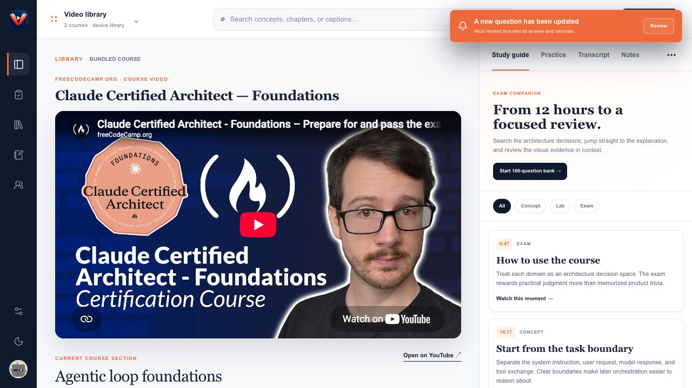
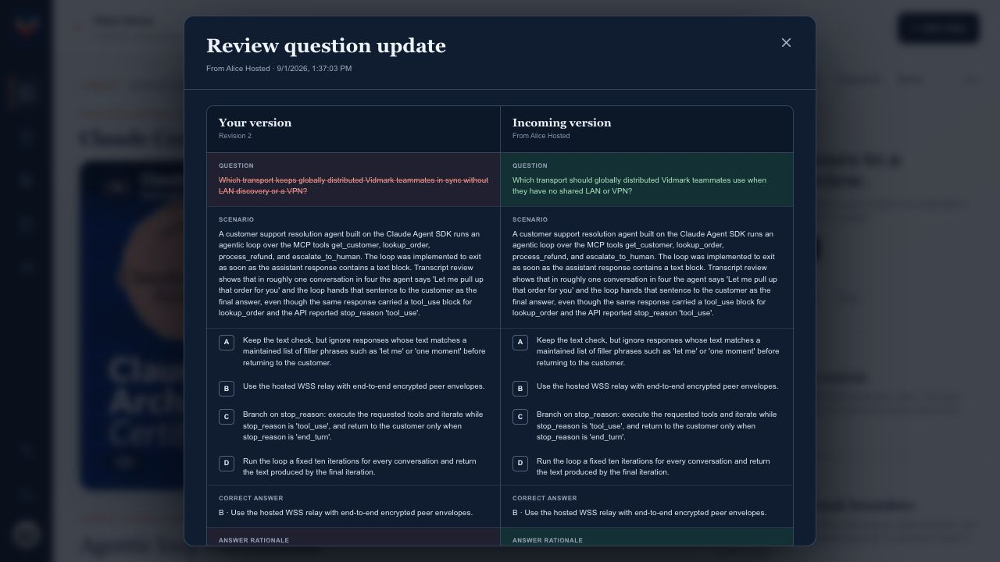
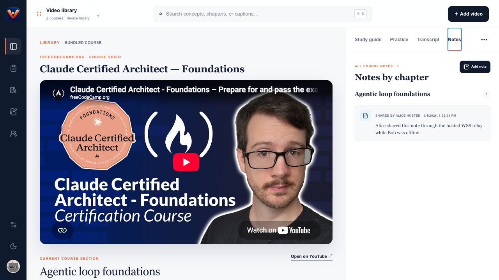
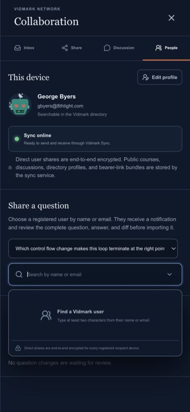

# Vidmark

**Turn a YouTube video into a complete, agent-built course—then study it, revise it, and share it.**

Vidmark is a native, local-first macOS study workspace with a 43-tool MCP server. Add a YouTube video, let Claude or another MCP agent acquire its public transcript and orchestrate the course build, then work through timestamped chapters, notes, concept graphs, practice questions, and exam sessions. Your private study data lives in SQLite on your Mac; selected courses, questions, and notes can be shared with registered Vidmark users through encrypted delivery.

`macOS 13+` · `Apple Silicon` · `Local SQLite` · `MCP` · `YouTube transcripts` · `Encrypted direct sharing`


## What you can do

- **Build a course with agents.** Import a YouTube URL, acquire available public captions, and have a coordinator delegate transcript analysis, research, chapters, labs, study-guide writing, assessments, concept mapping, and QA.
- **Study against the video.** Navigate timestamped chapters, search the transcript, capture text or locally transcribed voice notes, and jump back to the relevant moment.
- **Practice and review.** Work through complete questions with choices, answers, rationales, citations, grading guidance, and progress tracking.
- **Inspect the concept graph.** Every course owns an independently revisioned graph that is stored and shared with the course.
- **Collaborate asynchronously.** Find a registered user by name or email, send encrypted courses/questions/notes, review incoming question diffs, and manage everything from an unread-aware inbox.
- **Publish a shared version.** Register a global course by YouTube ID, fork it automatically when editing, propose revisions, and discuss the video in a public thread.
- **Bring your own model.** Use the in-app agent coordinator, Claude Desktop extension, Claude Code over HTTP MCP, or another MCP client.

## The workflow

1. **Add a video** with its YouTube URL and a credited course-building prompt.
2. **Build with an agent**; missing public captions are acquired before specialist agents create the course artifacts.
3. **Study locally** with chapters, transcript search, notes, concept graph, practice, and exam modes backed by one SQLite database.
4. **Share intentionally** by registered name/email or bearer URL. Direct user deliveries are end-to-end encrypted; incoming question changes require review unless that learner explicitly enables auto-import.

## Data boundaries

| Boundary | Data |
| --- | --- |
| **Local Mac** | Private courses, prompts, transcripts, chapters, question banks, concept graphs, notes, progress, exam attempts, model settings, and system-prompt overrides |
| **End-to-end encrypted delivery** | Courses, questions/answers/rationales, suggestions, and shared-note text sent directly to a registered user’s device keys |
| **Relay-readable collaboration** | Directory profiles, bearer-link course bundles, global course snapshots/revisions, and public video discussions |

The WebSocket is a persistent connection from each app to the hosted sync service. It provides authenticated directory RPC, immediate delivery, offline queueing, acknowledgements, and collaboration notifications. It is not a live session, shared editor, presence indicator, VPN, LAN-discovery mechanism, or direct peer-to-peer socket.

## Download

| Artifact | Use it for |
| --- | --- |
| [Vidmark 1.1.0 for macOS](releases/Vidmark-1.1.0.dmg) | Complete Apple Silicon desktop app for macOS 13 or newer |
| [Claude Desktop MCP Bundle](releases/Vidmark-1.1.0.mcpb) | Preferred Claude Desktop extension package |
| [Claude Desktop DXT compatibility build](releases/Vidmark-1.1.0.dxt) | Identical extension for versions whose picker still expects `.dxt` |

Open the disk image, drag Vidmark to Applications, and launch it. This repository build is ad-hoc signed rather than Apple-notarized, so the first launch may require Control-clicking Vidmark, choosing **Open**, and confirming. Vidmark then requests macOS notification permission for course invitations, question updates, shared notes, revisions, and discussion replies.

## Screenshots

| Question update | Review before import |
| --- | --- |
|  |  |

| Shared notes | Responsive People and Sync view |
| --- | --- |
|  |  |

## Run and package

The project uses the bundled Bun runtime for production packaging and `pnpm` for dependency scripts.

```bash
pnpm install
pnpm run dev
pnpm run package:dmg
pnpm run package:dxt
open releases/Vidmark-1.1.0.dmg
```

`package:dmg` creates a fresh optimized build, signs the app bundle, packages it with an Applications shortcut, and verifies `releases/Vidmark-1.1.0.dmg`. Use `pnpm run package:mac` when only `build/Vidmark.app` is needed.

`package:dxt` validates the current MCP Bundle v0.4 manifest, packages the Claude Desktop stdio bridge, and writes both `.mcpb` and `.dxt` release files. `pnpm run dxt:verify` exercises the bridge against an isolated real Vidmark MCP/SQLite instance.

The packaged app starts its own servers when it opens:

- app: `http://127.0.0.1:3010`
- local transcription: `http://127.0.0.1:31415`
- MCP: `http://127.0.0.1:31417/mcp`
- model provider: `http://127.0.0.1:31418`
- note storage: `http://127.0.0.1:31419`

## Course origin prompts

Every imported YouTube course requires an origin prompt and prompt credit. The prompt is stored with that course and is available to agents through MCP so research, chapters, study material, and question generation can follow course-specific instructions. The bundled CCA-F prompt is credited to Drake Fish.

Vidmark always restores two bundled freeCodeCamp courses when the library opens:

- Claude Certified Architect — Foundations, with its complete study guide and 100-question bank
- Learn Kubernetes in 6 Hours – Full Course with Real-World Project, with a coordinated build prompt that requires separate transcript, documentation-research, lab, study-guide, assessment, visual-reference, and independent-QA subagents

## Local MCP server

With Vidmark open, connect an MCP client to the Streamable HTTP endpoint:

```json
{
  "mcpServers": {
    "vidmark": {
      "url": "http://127.0.0.1:31417/mcp"
    }
  }
}
```

Vidmark currently exposes **43 tools** and one course-building prompt:

| Capability | MCP tools | What they enable |
| --- | --- | --- |
| Course library | `list_courses`, `get_course`, `upsert_course` | Discover courses, inspect the complete local record, and create or update course metadata and its credited prompt |
| Complete builds | `save_course_build`, `list_course_chapters` | Save a reviewed multi-artifact build atomically and read normalized chapters in display order |
| Concept graphs | `get_course_concept_graph`, `upsert_course_concept_graph` | Read or replace the independently revisioned graph owned by one course |
| Question bank | `list_course_questions`, `get_course_question`, `upsert_course_question`, `patch_course_question`, `archive_course_question` | Search, create, replace, merge-patch, or soft-delete complete questions with optimistic revision checks |
| Question review | `create_question_suggestion`, `list_question_suggestions`, `review_question_suggestion` | Stage create/update/archive proposals and accept or reject them atomically |
| Transcript | `get_transcript`, `replace_transcript`, `acquire_course_transcript` | Search timestamped cues, import a transcript, or retrieve an available public YouTube caption track |
| Notes | `list_notes` | Search text notes and locally transcribed voice-note text by course |
| Learner profile | `get_profile`, `upsert_profile` | Read or update the local name, email, and DiceBear avatar used for attribution |
| Sync and directory | `get_sync_status`, `search_vidmark_users` | Check this installation’s device-to-relay connection and find registered recipients by name/email |
| Direct encrypted sharing | `share_question_suggestion_with_user`, `share_course_question_with_user`, `share_note_with_user`, `share_course_with_user` | Deliver complete artifacts to every registered device for a selected Vidmark user; email is lookup-only and is never sent |
| Bearer links | `create_course_share_link`, `import_course_share_link`, `revoke_course_share_link` | Create, redeem, or revoke seven-day HTTPS course URLs, optionally one-time use |
| Inbox | `list_inbox`, `update_inbox_item`, `review_course_invite` | Filter invitations/updates, manage read state, and accept or reject course imports |
| Global course | `get_global_course`, `publish_course_version`, `make_course_private`, `import_global_course` | Read, register, publish, privatize, or import the locked course associated with a YouTube ID |
| Global revisions | `list_global_course_revisions`, `review_global_course_revision` | Inspect revision proposals and let the registered owner accept or reject them |
| Public discussion | `list_course_comments`, `post_course_comment` | Read or post comments and replies in the public thread keyed by YouTube ID |
| Preferences | `get_sync_preferences`, `update_sync_preferences` | Configure the relay URL and the learner-specific question auto-import setting |

The MCP prompt **`build_vidmark_course`** returns the selected course’s credited origin prompt inside an agent-ready workflow. It explicitly tells the agent to acquire a missing transcript first, coordinate bounded specialist subagents, review their artifacts, and persist the final course through the tools above.

Example requests to an MCP-connected agent:

```text
List my Vidmark courses and tell me which one is missing a transcript.

Build the imported Kubernetes course. Acquire its public captions first,
use specialist subagents for research, labs, assessment, concept graph, and QA,
then save the reviewed build to Vidmark.

Find George by email and share question q-17 from course kubernetes-full-course.
```

### Claude Desktop extension

1. Install Vidmark in `/Applications`, open it once, and create your learner profile. Every launch copies the extension bundled inside the app to `~/Library/Application Support/Vidmark/Claude Desktop/Vidmark.mcpb`.
2. Choose **Vidmark → Reveal Claude Desktop Extension…** to select that file in Finder. The repository download remains available as a fallback.
3. In Claude Desktop, open **Settings → Extensions → Advanced settings → Install Extension…** and choose `Vidmark.mcpb`. If that Claude version filters for `.dxt`, use the identical repository `.dxt` download instead.
4. Start a new Claude conversation and enable the Vidmark tools. Ask Claude to list courses, or use the `build_vidmark_course` prompt for an imported course.

The macOS app contains the same verified `.mcpb` published in `releases/`; copying it on launch does not install or enable it without the user's action in Claude Desktop. Claude Desktop launches the bundled Node bridge over stdio. The bridge starts the Vidmark app if necessary, waits for its loopback MCP service, and forwards MCP messages to `http://127.0.0.1:31417/mcp`. It contains no database and does not duplicate course state: all reads and writes continue through Vidmark's packaged server into `~/Library/Application Support/Vidmark/vidmark.sqlite`.

The repository bundle is unsigned for local installation. An organization that enforces signed Desktop Extensions must sign the `.mcpb` with its approved code-signing certificate before distributing it to employees.

### Import → Claude → study → share

1. Open **Add video**, paste a YouTube URL, enter the required course-specific prompt and credit, and choose **Add course**. A `.VTT` import is optional: when no transcript exists, the agent is instructed to call `acquire_course_transcript`, which retrieves an available public YouTube caption track, preserves its timestamps, and stores it in local SQLite. It does not bypass authentication or unavailable captions; if acquisition fails, provide a timestamped transcript manually.
2. Keep Vidmark open and connect Claude Code once:

   ```bash
   claude mcp add --transport http vidmark http://127.0.0.1:31417/mcp
   claude mcp list
   ```

3. On the imported course, choose **Build with agent**. Either run Vidmark's configured in-app coordinator, or choose **Copy setup command** and **Copy course task**. The task tells Claude to acquire missing public captions first, retrieve the `build_vidmark_course` prompt, coordinate bounded research/chapter/assessment/concept-graph/QA subagents, review their work, and save the complete build through MCP.
4. After the save, the imported course exposes its generated study guide and practice questions. **Share** finds a registered learner by name or email; the receiver gets an unread inbox invitation and imports the complete SQLite-backed course, including answers and its concept graph. Course URLs remain available as a separate sharing method.

The command above follows Anthropic's current [Claude Code HTTP MCP configuration](https://docs.anthropic.com/en/docs/claude-code/mcp). Claude Desktop uses the packaged local extension described above rather than its cloud-backed custom connector screen. The deterministic `pnpm run agent:verify` acceptance test uses the real Streamable HTTP protocol and an OpenAI-compatible model fixture; it cannot prove a particular employee's Claude account, model access, or generated course quality.

Run the repeatable agent plumbing check with:

```bash
pnpm run agent:verify
```

It creates a course and transcript through MCP, retrieves `build_vidmark_course`, saves chapters/questions/answers/concept graph to SQLite, verifies that the in-app coordinator writes the same SQLite database rather than legacy JSON, and imports the exported full-course bundle into a second isolated learner database.

### Local system prompt overrides

Open **Model settings → System prompts** to inspect every global instruction Vidmark sends to a model: the course-builder master prompt, in-app coordinator runtime and continuation instructions, specialist system prompt, and model connection probe. Each prompt can be overridden independently, restored to its built-in default, or reset together. Template variables such as `{{role}}` are shown beside prompts that support them.

Overrides are stored only in `~/Library/Application Support/Vidmark/system-prompts.json` with owner-only file permissions. They take effect immediately for new in-app builds and new `build_vidmark_course` MCP prompt requests. They are not stored in course SQLite records, bundled into course exports, synchronized to other users, included in bearer invites, or published with global courses. Course-specific credited origin prompts remain separate course data.

Vidmark stores profiles, courses, transcripts, chapters, questions, course-scoped concept graphs, suggestions, inbox state, cached public threads, global-course lineage, and audit events in `~/Library/Application Support/Vidmark/vidmark.sqlite`. SQLite uses WAL mode, foreign keys, atomic writes, and optimistic question and concept-graph revisions. Each course can own one independently revisioned concept graph; the bundled CCA-F graph is seeded into that course's database record rather than used as a global graph for every course.

The packaged desktop runtime currently uses `bun:sqlite` with explicit SQL in `scripts/vidmark-db.ts`; it does not use Drizzle ORM. The root `db/`, `drizzle/`, `drizzle.config.ts`, and `examples/d1/` files are unused Cloudflare D1 starter scaffolding and are not packaged or called by Vidmark. They remain only as examples, not as part of the application data layer.

The MCP and browser API bind only to `127.0.0.1`. Vidmark Sync is hosted-relay-only: the app does not advertise on the LAN, open an inbound port, require a VPN, or attempt direct device-to-device HTTP. Device encryption keys use X25519, relay authentication uses Ed25519 signatures, and direct user deliveries use AES-256-GCM. A learner's name, normalized email, avatar settings, device ID, and encryption public key are registered in the employee directory so other users can find them by name or email. Each successful sync connection refreshes that registration. Directory results group devices by normalized email into one logical user; courses, questions, and notes are encrypted separately to every registered device for the selected user.

## Encrypted study sync relay

Vidmark sends all collaboration traffic through a lightweight WebSocket relay so remote teammates can collaborate without sharing a network. Direct user/device deliveries are end-to-end encrypted, and the relay stores their ciphertext until it is acknowledged or expires. HTTPS bearer-link course bundles, employee directory metadata, global course snapshots, revision proposals, and public comments are intentionally readable by the relay. A 30-day retention limit and 12 MiB envelope limit bound private delivery storage.

The local relay runs in an Apple Container with one CPU, 256 MB of memory, a read-only source mount, and a named data volume:

```bash
pnpm run relay:start
pnpm run relay:status
pnpm run relay:verify
pnpm run relay:stop
```

`relay:verify` performs a real two-user check without pairing the devices. It finds the recipient through the registered-user directory, then covers offline question/note delivery, complete course sharing, inbox read filtering, HTTPS bearer invites, global registration, automatic forks, revision approval, and public comment replies. It also verifies one-time-use and revocation behavior, confirms that per-user question auto-import is disabled by default, and checks auto-import after Bob explicitly enables it.

Apple Container currently stalls when this repository under `Documents` is bind-mounted into its Linux VM, so `scripts/relay-apple-container.sh` stages only `relay/server.ts` under `/tmp` before starting the container. The repository remains the source of truth. `relay/Containerfile` is included for deployment environments where an image build is available.

Question updates do not merge automatically. The receiving learner sees “A new question has been added” or “A new question has been updated,” opens a red/green side-by-side diff that includes choices, correct answer, and rationale, then imports or rejects it. Auto-import is a per-user preference and defaults to off. Notes shared by another user are read-only and retain their author attribution.

### Course sharing, inbox, and public collaboration

Complete courses—including their transcript, chapters, study guide, questions and answers, and concept graph—can be sent to a registered employee found by name or email, or through a normal seven-day `https://…/invite/…` bearer URL. An email address is only a Vidmark directory identifier: Vidmark looks up the registered profile and adds the invitation to that user's in-app inbox; it does not send email. The Share drawer's recipient combobox searches only registered names and email addresses; it does not accept device-pairing codes or show paired devices. Direct deliveries are encrypted independently to every directory key registered for the selected logical user. Bearer URLs are fragment-free, revocable, and optionally one-time-use; anyone holding the URL can import its relay-readable course bundle, so it should be handled like a password. Every received course remains pending in the SQLite inbox until the learner imports or rejects it; read/unread state is independent from that decision. Global course snapshots and revision proposals use the same complete versioned bundle, so their concept graphs travel with them too.

Public discussions and global courses use the canonical 11-character YouTube video ID, regardless of which local course copy a learner has. The first learner to publish a course for a video registers the locked global snapshot. Editing that locked local snapshot automatically changes the local version to private and records the global version it forked from. The global owner can publish their own fork directly; other learners submit revision proposals that the owner accepts or rejects. Public comments and replies form one video-level thread shared by every course associated with that YouTube ID.

### macOS desktop notifications

The packaged app requests native macOS notification permission and keeps its local relay client running after the last Vidmark window closes; choose **Vidmark → Quit Vidmark** to stop it completely. New course invitations, manually reviewed question updates, shared notes, global revision requests or decisions, and replies to the learner's public comments enter a durable SQLite notification feed. Vidmark displays a Dock badge, avoids duplicating banners while its window is frontmost, and opens the relevant Inbox, People, or Discussion area when a banner is clicked. Notification access can be changed from **Vidmark → Notification Settings…** or macOS System Settings.

### Production relay

The public relay is available at `wss://vidmark-159-223-136-163.sslip.io/ws`. The free, open-source sslip.io DNS service maps that hostname to the DigitalOcean IP address. Caddy terminates publicly trusted TLS and proxies WebSocket traffic to an internal-only relay container; only ports 80 and 443 are exposed. Docker volumes persist the relay queue and Caddy certificates across restarts.

There is deliberately no public REST endpoint for employee-directory lookup. The relay's authenticated WebSocket RPC is the API in front of its persistent SQLite database: signed devices call `directory_register` and `directory_search`, while local Vidmark exposes the result to its own UI and MCP at `/api/directory` and `search_vidmark_users`. This prevents a bare unauthenticated HTTP endpoint from becoming an employee-email enumeration surface. Profiles are currently self-asserted; normalized-email grouping is device inference, not proof that a person owns that address. Organization SSO or signed employee enrollment is required before treating directory identity as verified authentication.

The production relay also limits each device to five sockets, 120 messages per minute, 250 pending messages, 100 MiB of queued content, and 12 MiB per envelope. A sender can only queue an envelope for a recipient that has already authenticated with the relay.

Run the full encrypted two-user verification against production with:

```bash
pnpm run relay:verify:production
```

### Verified two-instance hosted sync

On September 1, 2026, the complete rendered workflow was verified with two isolated Vidmark instances on one Mac. Alice ran at app/MCP ports `3011`/`31517`; Bob ran at `3022`/`32517`. Each instance used its own SQLite data directory, and both connected exclusively to `wss://vidmark-159-223-136-163.sslip.io/ws`.

The verification covered:

- connecting Alice and Bob independently to Vidmark Sync with no live session, device pairing, LAN discovery, VPN, or direct device-to-device connection
- finding Bob by registered name/email and encrypting direct deliveries separately for his registered device keys
- taking Bob offline while Alice queued one complete question/answer update and one attributed note
- observing two pending encrypted envelopes at the relay, then zero after Bob reconnected and acknowledged them
- showing the exact “A new question has been updated” notification and a red/green revision diff containing choices, correct answer, and rationales
- confirming auto-import was off by default, manually importing revision 3, and preserving Alice's note as read-only with author attribution
- finding Bob by registered email, delivering an encrypted complete-course invitation, filtering it as unread, and importing its question bank
- creating and resolving a seven-day HTTPS bearer invite, including one-time-use and revocation checks
- registering a global video course, automatically forking a locked copy on edit, submitting a non-owner revision, and accepting it as global version 2
- posting a public video-level comment and reply shared by both isolated instances
- checking clean browser consoles in fresh sessions and a `390 × 844` viewport with no horizontal overflow

The app and MCP endpoints are configurable for isolated QA with `VIDMARK_APP_PORT`, `VIDMARK_VITE_CACHE_DIR`, `VIDMARK_MCP_PORT`, `VIDMARK_DATA_DIR`, `VIDMARK_ALLOWED_ORIGINS`, and `VITE_VIDMARK_LOCAL_ORIGIN`. `pnpm run relay:verify:production` provides the repeatable protocol-level two-user check; the rendered evidence appears in the screenshot gallery near the top of this README.

## Voice notes

Voice notes are recorded as WAV audio and transcribed by the on-device Whisper worker. Saving writes the transcript and metadata to `~/Library/Application Support/Vidmark/notes/notes.json` and the recording to `~/Library/Application Support/Vidmark/notes/audio/<note-id>.wav`. The aggregate notes view and each chapter's Notes panel include a sortable recording playlist with play/pause, scrubbing, elapsed time, and an expandable transcript. Existing IndexedDB notes migrate into the disk store the next time notes load; browser storage remains a fallback if the local service is unavailable.
