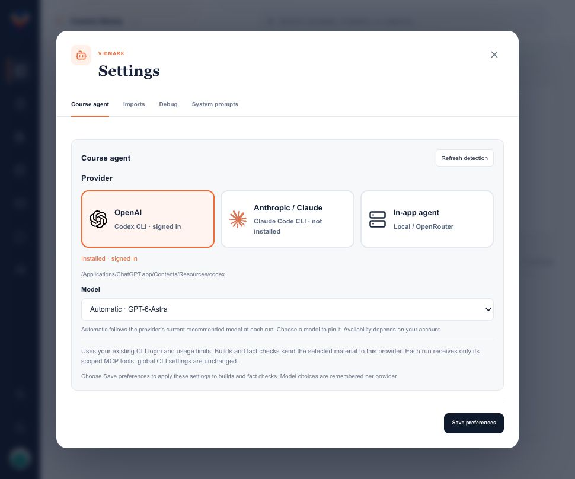
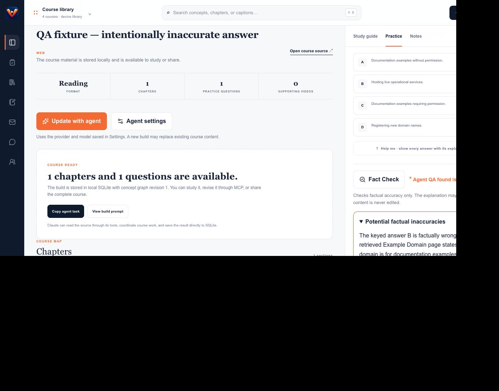

# Provider and fact-check verification

Local development verification, 2026-09-10. This is test evidence, not a claim that generated courses are factually certified.

## Environment

- macOS arm64; UI `http://localhost:3011/`; isolated MCP/provider ports 33447/33448.
- Database and diagnostics: `/tmp/vidmark-harness-ui.Xwt7t0/`. The real Vidmark library was not modified.
- Signed-in Codex CLI discovered at `/Applications/ChatGPT.app/Contents/Resources/codex`. Automatic selection resolved the model from its live recommendation metadata.
- Claude Code was not installed. Missing-install UI and protocol fixtures passed; live Claude execution was not verified.

## UI and integration checks

1. Opened Settings; selected provider icon radio cards; verified selected border, truthful installation state, and automatic model selection. Saved and reopened preferences. No Build tab or build action exists in Settings.
2. Started a build from the course overview. Codex fetched Example Domain and saved one chapter, one complete question, study guide, research notes and graph through the scoped MCP endpoint. Invalid intermediate saves were rejected before a valid atomic save succeeded.
3. Started Fact Check from the generated question. The agent read the question, retrieved Example Domain and IANA evidence, and saved an accurate verdict with reasoning.
4. Created a separate, explicitly labeled negative-test fixture with an intentionally incorrect keyed answer. Started Fact Check through the UI. The agent flagged the incorrect key but did not change it.
5. Checked provider cards at 390px width and desktop width. Browser error/warning log was empty. Source, answers, reports and provider controls remained usable.

| Run | Job ID | Local diagnostic outcome (UTC) |
| --- | --- | --- |
| Course build | `5bad982f-c904-47f8-b430-e8eea9d859a6` | `save_course_build ok:true` at 20:35:00; `build.complete` at 20:35:07 |
| Accurate question | `17b0d63f-97ed-41a2-b00d-57b9d16ae7a7` | `record_fact_check ok:true` at 20:36:09; `fact-check.complete` at 20:36:14 |
| Incorrect answer | `d683078f-eb10-40b0-8b23-a0f7d15a58f6` | `record_fact_check ok:true` at 20:40:19; `fact-check.complete` at 20:40:24 |

Before and after review, both questions retained revision 1 and the same content hashes:

- Accurate: `e76f1dffbd0b5f8c6e720ae4b5e8cadf977131235237b264faefb1feab6fdbef` (answer A).
- Intentionally inaccurate: `368ab7b560eb441d3e948635f54b653cd3feb88eba293802e2dbc0c788dec491` (answer B, still unchanged after being flagged).

## Automated checks and limits

- Run `pnpm test` for the production build and regression suite, including immutable reports, stale-version rejection, tool scope, cancellation, missing evidence, optional QA, provider preferences and model resolution.

### Review regressions

- Scoped edits preserve archived questions and historical reviews; staged banks still commit atomically.
- Both course-build runtimes require an exact question read and successfully retrieved evidence IDs before recording QA. An explicit inconclusive result can record missing evidence.
- Research connections pin validated public IPs, revalidate redirects, preserve TLS verification, and enforce a 2 MiB response limit while streaming. Citations accept only credential-free HTTP(S) URLs.
- In-app builds expose cancellation, propagate abort signals to model/research calls, and preserve a truthful saved status if optional QA fails afterward.
- Fact-check completion refreshes exam QA metadata only for matching content hashes, leaving frozen questions and answers unchanged.
- CLI discovery verifies every flag needed for isolated launches.
- Full-MCP QA now requires an expiring question/evidence session; the general endpoint cannot directly approve invented citations.
- Local builds stage incremental banks until the complete atomic save. Failed/cancelled builds leave no staged questions behind, and video saves require a transcript.
- Imports retain archived flags and record shared QA in the history endpoint without duplicate-import entries.
- Fact checks read a hash-bound transcript snapshot; build/discovery cancellation reaches login/catalog subprocesses and caption requests.
- Transcript UI derives from the refreshed active course. The copied external handoff explicitly identifies its trusted, full-library scope.
- Workflow integration verification passes: SQLite artifacts, transcript retention, 48 full-library MCP tools, local coordinator and shared course import.
- Production frontend build and native arm64 server compilation pass; changed-file lint and whitespace checks pass.
- Whole-repo TypeScript checking still reports existing errors in the D1 example, worker platform types and the packaged-lifecycle stream test.
- This run verifies a small reading-based integration fixture, not completion or accuracy of the full YouTube crash course. The installed application and release artifacts have not been updated with these provider changes.
